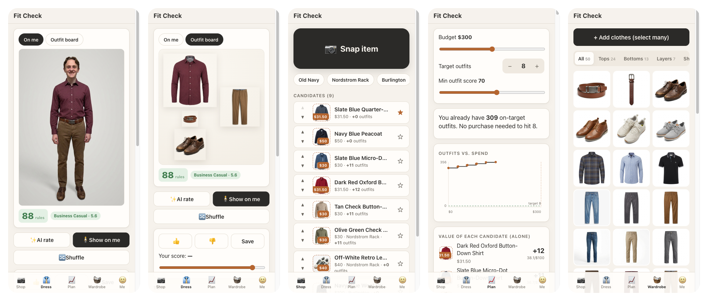

# Fit Check

**Plan a work wardrobe from your phone: try outfits on a photo of yourself, and find the cheapest purchases that complete your week.**

Fit Check turns photos of your clothes into clean studio product shots and lets you mix them into outfits. You can render
any outfit on a photo of yourself. In a store, snap an item and its price tag to see how many new outfits it would
unlock, and a built-in optimizer finds the **cheapest set of purchases** that gives you a full work week.

It is self-hosted: the server runs on your laptop, your phone connects through a Cloudflare tunnel, and your photos never
leave your machine except to go to the AI APIs you configure.

<p align="center"></p>

## Features

| | |
|---|---|
| **Wardrobe** | Bulk-upload photos of shirts, pants, sweaters/layers, shoes and belts. Each becomes a pressed, ghost-mannequin studio image and is auto-tagged with type, color, pattern and formality (1–10). |
| **Me** | Upload one full-body photo. The background is removed, but your face and body pixels are kept exactly as they are, never regenerated. |
| **Dress** | Pick an item per slot. You get an instant flat-lay board plus compatibility and formality scores computed locally, with no AI cost. Tap **Show on me** to render the full outfit on your photo, shoes and belt included (~13¢, cached so you never pay twice). Rate outfits yourself to override the AI. |
| **Shop** | In a store, snap the item, then type the price or snap the tag. See it as a studio image and on you, and see how many new on-target outfits it unlocks. Star, rank or reject candidates. |
| **Plan** | Set a budget, a target outfit count and a minimum score. Get the cheapest purchase set, an outfits-vs-spend curve, and each candidate's marginal value. |
| **AI spend** | Every paid call is logged with token counts and cost (Me tab → AI spend). |

### How it keeps costs low

Images are only generated when something new enters the app (a garment, your photo) or when you explicitly ask to see an
outfit on you. Outfit boards, scores and the optimizer run locally, so trying 500 combinations costs nothing. Every AI
result is cached by its inputs.

| Action | Model | Approx. cost |
|---|---|---|
| Studio image per garment | Gemini 3.1 Flash Image | ~7¢ |
| Tagging, wardrobe match, outfit rating | Gemini Flash | < 1¢ each |
| Background removal on your photo | Stability AI on Amazon Bedrock | ~7¢, once |
| Outfit rendered on you | Gemini 3 Pro Image | ~13¢, cached |

Digitizing a 50-item wardrobe costs about $4. A shopping trip with ten scanned items and ten renders costs about $2.

## Quick start

**You need:** Node 22+, [`cloudflared`](https://developers.cloudflare.com/cloudflare-one/connections/connect-networks/downloads/)
(`brew install cloudflared`), and a [Gemini API key](https://aistudio.google.com/apikey). An AWS account with Bedrock is
optional (it removes the background from your photo; without it your photo is used as-is).

```bash
git clone https://github.com/jpatrickb/fit-check.git && cd fit-check
npm install
cp .env.example .env      # set APP_PASSWORD and GEMINI_API_KEY (+ AWS_PROFILE, GARMENT_FIT if you like)
npm run phone             # builds, starts the server and a tunnel, prints a link for your phone
```

Open the printed link on your phone, enter your `APP_PASSWORD`, and use **Add to Home Screen** to get an app-like icon.

**Just looking?** `MOCK_AI=1 npm run phone` runs the whole UI with fake AI output: no keys, no cost.

### A permanent link on your own domain

By default you get a random `*.trycloudflare.com` link that changes every time you start the app. If you have a domain on
Cloudflare:

```bash
cloudflared tunnel login                              # once per machine; pick your domain in the browser
npm run tunnel:setup -- fitcheck.example.com          # creates the tunnel + DNS, saves settings to .env
npm run phone                                         # now always at https://fitcheck.example.com
```

### Keep it running (macOS)

```bash
npm run service -- install     # start at login, restart automatically if it stops
npm run service -- status      # logs: ~/Library/Logs/fit-check.log
npm run service -- restart     # after pulling new code or editing .env
npm run service -- uninstall
```

## Your data

- Everything lives in `data/` (`db.json`, `images/`, and `usage.jsonl` for AI costs). It is git-ignored.
- The server backs up to `~/FitCheck-backups` on start, every 30 minutes and on shutdown. Images are copied
  incrementally, and each change to `db.json` is kept as a timestamped snapshot (the last 200). Set `BACKUP_DIR` to an
  iCloud Drive or Dropbox folder for an off-machine copy.
- `npm run backup` backs up now. `npm run restore` lists snapshots, and `npm run restore -- latest` restores the newest
  one (stop the server first).

## Configuration

All settings live in `.env`; see [`.env.example`](.env.example). The main ones:

| Variable | Purpose |
|---|---|
| `APP_PASSWORD` | Required whenever the app is reachable from the internet. |
| `GEMINI_API_KEY` | Studio images, outfit renders, tagging, scoring. |
| `AWS_PROFILE`, `AWS_REGION` | Optional. Amazon Bedrock for background removal (and Claude for tagging, if enabled on your account). |
| `GARMENT_FIT` | e.g. `men's` or `women's`. Steers studio images to the right cut. |
| `TUNNEL_NAME`, `PUBLIC_HOSTNAME` | Set by `npm run tunnel:setup` for a permanent link. |
| `DATA_DIR`, `BACKUP_DIR` | Where data and backups live. |
| `GEMINI_RENDER_MODEL`, `GEMINI_IMAGE_MODEL`, `GEMINI_TEXT_MODEL` | Override the models used. |
| `MOCK_AI=1` | Fake AI output for development and demos. |

## How it works

```
 phone (React PWA) ──HTTPS──▶ Cloudflare tunnel ──▶ laptop: Hono server ──▶ Gemini / Bedrock
                                                        │
                                                        └── data/ (db.json + images) ──▶ ~/FitCheck-backups
```

- **`shared/`** holds the data contract (`types.ts`), rule-based outfit scoring and the purchase optimizer. These are pure
  TypeScript, shared by server and client, and unit-tested. The optimizer searches every subset of candidates when there
  are 16 or fewer, and runs a greedy marginal-outfits-per-dollar search otherwise.
- **`server/`** is a Hono API with a JSON file store and the AI pipeline (`ai.ts`). It also tracks costs (`usage.ts`)
  and runs backups (`backup.ts`).
- **`web/`** is a mobile-first React 19 + Vite single-page app with five tabs.

More detail: [docs/ARCHITECTURE.md](docs/ARCHITECTURE.md).

## Development

```bash
npm run dev          # API server (watch mode) + Vite dev server with /api proxy, at http://localhost:5173
npm test             # scoring + optimizer tests
npm run typecheck
```

Contributions are welcome; see [CONTRIBUTING.md](CONTRIBUTING.md). For security issues, see [SECURITY.md](SECURITY.md).

## Limitations

- Renders come from a generative model. Your face and build are strongly preserved, but small details can drift.
  Re-rendering, or using a clear, well-lit front-facing photo, helps.
- Single user by design: one password, one wardrobe.
- The laptop has to be on and online while you use the app from your phone.

## License

[MIT](LICENSE)
